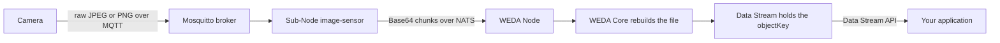
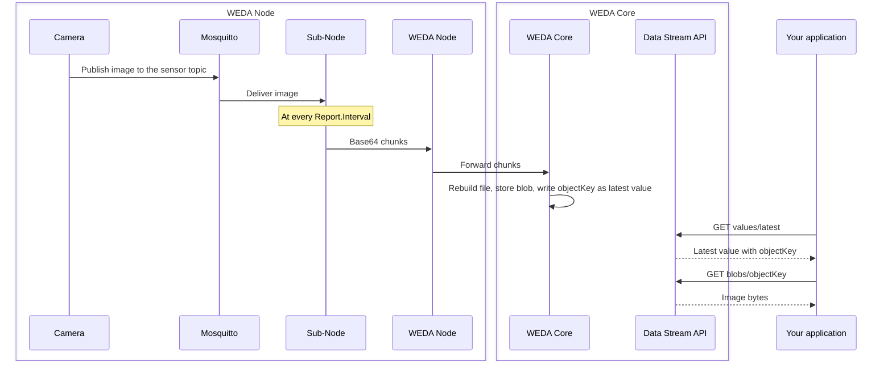

# WEDA Sub-Node Image Publishing: End-to-End Integration Guide

**Who this is for:** integrators who publish images from a Sub-Node on a WEDA Node and read them back from WEDA Core.

## Overview

A Sub-Node on a WEDA Node can publish JPEG or PNG images to WEDA Core, and your application can read them back through the Data Stream API. In Advantech's test of these steps, a 2.7 MB JPEG came back byte for byte about 2 minutes after publishing.

In this guide you run the public [`mqtt-image-chunked` example](https://github.com/Advantech-WEDA/WEDA-Sub-Node/tree/release/v1.2.0/examples/mqtt-image-chunked), publish a test image, download it through the API and compare checksums. You then connect your own camera.



The Sub-Node sends each image as Base64 chunks through the WEDA Node. WEDA Core rebuilds the file, and Data Stream holds its `objectKey`.

### Publish and read sequence

Publishing and reading are separate flows: the Sub-Node sends on its report interval, and your application reads when it needs an image.



The `objectKey` in the latest value links the two flows. Solid arrows are calls, and dashed arrows are responses.

### Test results and release status

These results came from running this guide on `release/v1.2.0` on an x64 WEDA Node:

| Image tested | Size | Result |
| --- | --- | --- |
| JPEG | 2,705,552 bytes | MD5 matches, readable after 1 min 51 s |
| JPEG | 250,557 bytes | MD5 matches, readable after about 2 min |
| JPEG | 65,115 bytes | Not delivered, see [Limits and behaviour to design for](#limits-and-behaviour-to-design-for) |

**Release covered.** This guide uses the `release/v1.2.0` example at `examples/mqtt-image-chunked`. Advantech's test ran on a development build of WEDA Core.

**Evaluation status.** Use test images only while you evaluate this route, and repeat Step 6 on your own system. ARM64, `build.sh` and `docker-compose.deploy.yml` have not been tested.

## Before you start

You need a connected WEDA Node with internet access, and a token for the WEDA API.

| Item | Where to get it |
| --- | --- |
| WEDA domain, tenant and `orgId` | Your WEDA administrator or WEDA Console |
| User access token | [Create a JWT access token](https://learn.advantech.com/weda/api/create-jwt-access-token/) |
| WEDA Node showing Activated, Connected and Running | [Onboard your device](https://learn.advantech.com/weda/docs/getting-started/onboard-your-device/) |
| Docker Engine 27.5+ and Compose 2.32.4+ on Linux, x64 or ARM64 | [Node installation guide](https://learn.advantech.com/weda/docs/developer-resources/node-activator/installation-guide/) |
| Node's local NATS username and password | `/opt/Advantech/system-agent/systemcfg.json` on the Node |
| TCP port 1883 free on the Node | The MQTT broker uses host networking |
| Access from the Node to Docker Hub, `mcr.microsoft.com` and `api.nuget.org` | Needed to build the Sub-Node image |
| `curl` and `jq` | Any machine that reads images back |

Set these once for the commands in this guide:

```bash
export WEDA=https://weda.example.com/central/weda/api/v1   # central is your tenant
export ORG=<orgId>
export USER_TOKEN=<user access token>
```

## Step 1: Get the example

Clone the example onto the WEDA Node. Compose builds the Sub-Node image from this checkout, so you do not need a registry.

```bash
git clone -b release/v1.2.0 https://github.com/Advantech-WEDA/WEDA-Sub-Node.git
cd WEDA-Sub-Node/examples/mqtt-image-chunked
```

Run the remaining commands on the Node from this folder.

If the Node cannot reach those sites, build on another machine with `build.sh` and push to your own registry. Then set `IMAGE_SENSOR_IMAGE` in `.env`, and leave out `--build` in Step 3.

## Step 2: Configure the example

The example needs four changes before it can carry a real image: the password, the sample sensor, a sensor for your image, and the broker limit.

1. Create `.env` with these values. `SUBNODE_NAME` must be unique in your organization.

   ```bash
   WEDA_NODE_URL=127.0.0.1:4224
   WEDA_NODE_AUTH_STRATEGY=UserPassword
   WEDA_NODE_USERNAME=<from /opt/Advantech/system-agent/systemcfg.json>
   WEDA_NATS_PASSWORD=<from /opt/Advantech/system-agent/systemcfg.json>
   SUBNODE_NAME=ImageSensor-Line1
   ```

   Use the name `WEDA_NATS_PASSWORD`. `docker-compose.yml` reads that name, not the `WEDA_NODE_PASSWORD` shown in `.env.sample`.
2. In `devicecfg.json`, delete the `MnistCamera` entry from `Sensors`. Its sample PNGs are too small to be chunked, and an unchunked image in the same report as a chunked one makes the whole send fail.
3. In `devicecfg.json`, add this entry to `Sensors` for your test image.

   ```json
   {
     "Name": "LineCamera",
     "SensorGroup": "SYS",
     "Parameters": { "Topic": "sensor/image/line1" },
     "SensorInfo": {
       "DisplayName": "Line Camera",
       "Description": "Receives JPEG images via MQTT",
       "Schema": "image/jpeg"
     },
     "Record": { "Enabled": false, "Interval": 5000 },
     "Report": {
       "Enabled": true,
       "Interval": 30000,
       "TransformPipeline": [
         { "Type": "chunking", "Enabled": true }
       ]
     }
   }
   ```

   Leave out `Parameters` in the `chunking` entry. In this release, any `chunkSize` set there makes every report fail, and the image is dropped. Without it, images are split into 256 KB chunks.
4. In `docker-compose.yml`, add `max_packet_size` to the `command` of the `mqtt` service. Without it, the current `eclipse-mosquitto:2` image rejects images of about 2 MB or more. Editing `mosquitto/config/mosquitto.conf` has no effect in this version.

   ```yaml
   command: ["printf 'listener 1883 0.0.0.0\\nallow_anonymous true\\nmax_packet_size 12000000\\n' > /tmp/mosquitto.conf && exec mosquitto -c /tmp/mosquitto.conf"]
   ```

## Step 3: Start the Sub-Node

Compose builds the image on the first start, then starts the broker and the Sub-Node.

```bash
sudo docker compose up -d --build
sudo docker compose logs -f image-sensor
```

The log shows `Subscribed to image topic: sensor/image/line1`. The example's simulator keeps logging `Published digit_X.png` every 30 s, and those samples are ignored now that `MnistCamera` is gone. You can also ignore the warning that `systemcfg.json` contains a `Record` section.

The Sub-Node registers itself with WEDA Core, so you do not create a device by hand. Compose keeps its registration in `/opt/Advantech/weda/node/image-sensor`. Keep that folder across restarts so the Sub-Node keeps its identity.

## Step 4: Publish a test image

Publish one JPEG and record its MD5. The image must be larger than about 200 KB, because smaller images are not delivered. The log shows `Image received` at the next report.

```bash
md5sum test.jpg
sudo docker cp test.jpg image-sensor-mqtt:/tmp/test.jpg
sudo docker exec image-sensor-mqtt mosquitto_pub -h 127.0.0.1 -t sensor/image/line1 -f /tmp/test.jpg
```

## Step 5: Find the Sub-Node and its data stream

A device of type `SubNode` appears under your Node. Its `LineCamera` data stream appears once the image reaches WEDA Core, so allow up to 4 minutes.

Use the Sub-Node's `deviceId` from here on, not the Node's, because images are stored against the Sub-Node.

```bash
AUTH="Authorization: Bearer $USER_TOKEN"
export NODE=<WEDA Node deviceId>

# Find the Sub-Node
curl -sS "$WEDA/orgs/$ORG/devices?maxResultCount=100" -H "$AUTH" \
  | jq -r '.items[] | select(.parentDeviceId==env.NODE) | "\(.deviceId) \(.deviceName) \(.type)"'
export DEVICE=<Sub-Node deviceId>

# Find the data stream
curl -sS "$WEDA/orgs/$ORG/devices/$DEVICE/data-streams" -H "$AUTH" \
  | jq -r '.items[] | "\(.dataStreamId) \(.dataStreamName)"'
export STREAM=<dataStreamId of LineCamera>
```

## Step 6: Read the image and verify it

Reading takes two calls: the latest value gives you the file's `objectKey`, then the [blob content API](https://learn.advantech.com/weda/api/get-assigned-device-binary-data/) returns the file.

```bash
BASE="$WEDA/orgs/$ORG/devices/$DEVICE/data-streams/$STREAM"

# 1. Read the object key from the latest value
KEY=$(curl -sS "$BASE/values/latest" -H "$AUTH" | jq -r '.dataObject.value | fromjson | .objectKey')

# 2. Download the image
curl -sS "$BASE/blobs/$KEY" -H "$AUTH" -o out.jpg
md5sum out.jpg
```

The round trip passes only when this MD5 equals the one from Step 4. A `200` response alone does not prove the image is intact.

- **`objectKey`:** send it as returned. It contains slashes, and a percent-encoded key returns `400`.
- **`dataType`:** image streams currently show `string`. Parse `value` as JSON and do not branch on the type.
- **`originalFilename`:** this holds the transfer ID, not a camera file name.
- **File type:** the file is stored with a `.bin` name and served as `application/octet-stream`. Name it from the sensor's `Schema`, not from the response.
- **History:** `/values/historical?start=&end=` returns the same JSON text in `dataObjects[].value`. Page with `nextCursor` until `hasMore` is false.
- **Blob metadata:** `/blobs/{blobId}/metadata` returns `422` on a Sub-Node stream, so call `/blobs/{objectKey}` directly.

## Move to your own camera

The `LineCamera` sensor from Step 2 is already the pattern for a real camera. The remaining changes remove the simulator and lock down the broker.

1. Delete the `AddHostedService` block from `Program.cs`, then rebuild with `sudo docker compose up -d --build`.
2. Publish raw JPEG or PNG bytes to the topic in `Sensors[].Parameters.Topic`, one MQTT message per image.
3. Set `SensorInfo.Schema` to `image/jpeg` or `image/png` to match the camera.
4. Set `Report.Interval` to the period you need, in milliseconds.
5. Keep every image larger than about 200 KB. `chunkSize` cannot be set in this release, so the 256 KB default applies.
6. Add one `Sensors` entry per camera, each with its own topic. More than one camera has not been tested.
7. In the `command` of the `mqtt` service, change `listener 1883 0.0.0.0` to `listener 1883 127.0.0.1`. The broker allows anonymous connections, and `MqttImageDevice` has no broker login or TLS option. If the camera is on another machine, keep the listener and put the camera on an isolated network.

To manage the Sub-Node from WEDA instead of running Compose by hand, deploy `docker-compose.deploy.yml` as a [Container Stack](https://learn.advantech.com/weda/docs/developer-resources/subnode-sdk/deploy/). Set your own image in that file, supply the Node password through `SystemConfig__WedaNode__Password`, and make the same broker changes there.

## Limits and behaviour to design for

Plan for images between about 200 KB and 2.7 MB, the sizes tested, and for about 2 minutes between publishing and a readable image.

| Limit | Value |
| --- | --- |
| Largest image | 10 MB of Base64, about 7.5 MB raw. Largest size tested: 2.7 MB |
| Smallest image | About 200 KB. 250 KB was delivered, and 65 KB was not |
| Mosquitto message | About 2 MB by default on the current `eclipse-mosquitto:2` image |
| Chunk size | 256 KB, the default. `chunkSize` cannot be set in this release |
| Publish to readable | About 2 minutes at `Report.Interval` 30000 |
| Latest value retention | 25 hours by default |

Five behaviours affect how you size and run the system:

- **Small images:** an image smaller than about 200 KB is not delivered, and neither the Sub-Node nor WEDA Core reports an error.
- **Repeat sends:** the Sub-Node re-sends the last image at every `Report.Interval` while no new image arrives. Size storage for one image per camera per interval.
- **Broker restarts:** the Sub-Node does not reconnect on its own. Restart it after any broker restart.
- **Outages:** do not rely on images being re-sent after an outage. Resending stored images to WEDA Core is not available in this release.
- **Latest value:** `/values/latest` can briefly lag behind the camera, so do not treat it as a live frame.

## Troubleshooting

The first failures with a real camera are usually the broker's message limit and a lost broker connection. WEDA shows neither, so check the broker and Sub-Node logs.

| Symptom | Cause | Fix |
| --- | --- | --- |
| `Transform failed` and `could not be converted to System.Int32` in the Sub-Node log | `chunkSize` is set in `Parameters` | Remove `Parameters` as in Step 2, then restart the Sub-Node |
| `Send failed: The given key 'transferId' was not present` in the Sub-Node log | A small image and a chunked image share a report | Delete `MnistCamera` as in Step 2, and keep every image above about 200 KB |
| `Image received` in the log, no error, but no new value in WEDA Core | The image is smaller than about 200 KB | Use a larger image |
| Authentication failure in the Sub-Node log | `WEDA_NATS_PASSWORD` is missing or wrong | Set it in `.env`, then run `sudo docker compose up -d` |
| `409 Device name already in use` | Another device in the organization has this name | Set a unique `SUBNODE_NAME` in `.env`, then run `sudo docker compose up -d` |
| `The connection was lost` from the publisher, `oversize packet` in the broker log | Image is above the broker's limit of about 2 MB | Add `max_packet_size` as in Step 2 |
| Images stop after a broker restart, with `MQTT client disconnected` in the log | The Sub-Node does not reconnect | Restart the Sub-Node |
| Permission denied from Docker | Your user is not in the `docker` group | Use `sudo`, or add the user to the group |
| Empty data stream list | You used the Node's ID, or the first image has not reached WEDA Core | Use the Sub-Node's `deviceId` and allow up to 4 minutes |
| `204` on `/values/latest` | No value in the 25-hour window | Use `/values/historical` |
| `400` on `/blobs/...` | The key was percent-encoded | Send the slashes as returned |
| `422` on blob metadata | Sub-Node streams have no metadata record | Call `/blobs/{objectKey}` directly |
| `403` | Token lacks `data-stream.read` or `blob.read`, or has no access to the organization | Use a token with both scopes |

## API reference

All calls use a bearer token and start from `https://{domain}/{tenant}/weda/api/v1`.

| Call | Use it to |
| --- | --- |
| `GET /orgs/{orgId}/devices?maxResultCount=100` | Find the Sub-Node by its `parentDeviceId` |
| `GET /orgs/{orgId}/devices/{deviceId}/data-streams` | Find the data stream for a sensor |
| `GET .../data-streams/{dataStreamId}/values/latest` | Read the latest `objectKey` |
| `GET .../data-streams/{dataStreamId}/values/historical?start=&end=` | Read earlier `objectKey` values |
| `GET .../data-streams/{dataStreamId}/blobs/{objectKey}` | [Download the image](https://learn.advantech.com/weda/api/get-assigned-device-binary-data/) |

Related: [`mqtt-image-chunked` example README](./README.md), [Sub-Node SDK deployment](https://learn.advantech.com/weda/docs/developer-resources/subnode-sdk/deploy/), [Create a JWT access token](https://learn.advantech.com/weda/api/create-jwt-access-token/).
